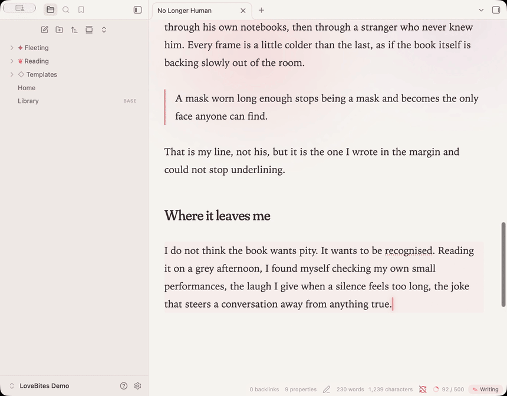
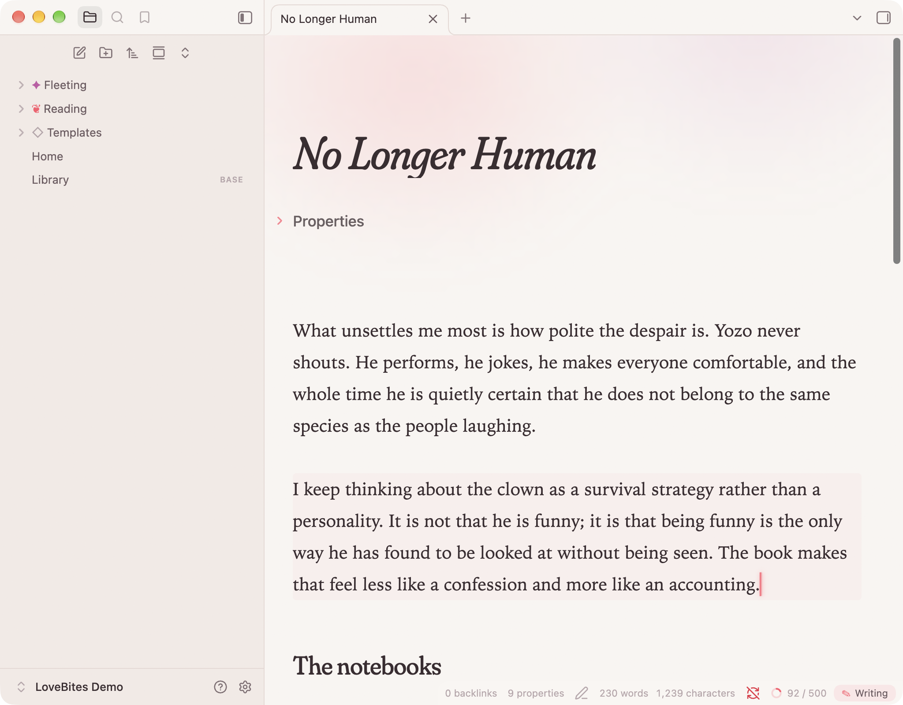
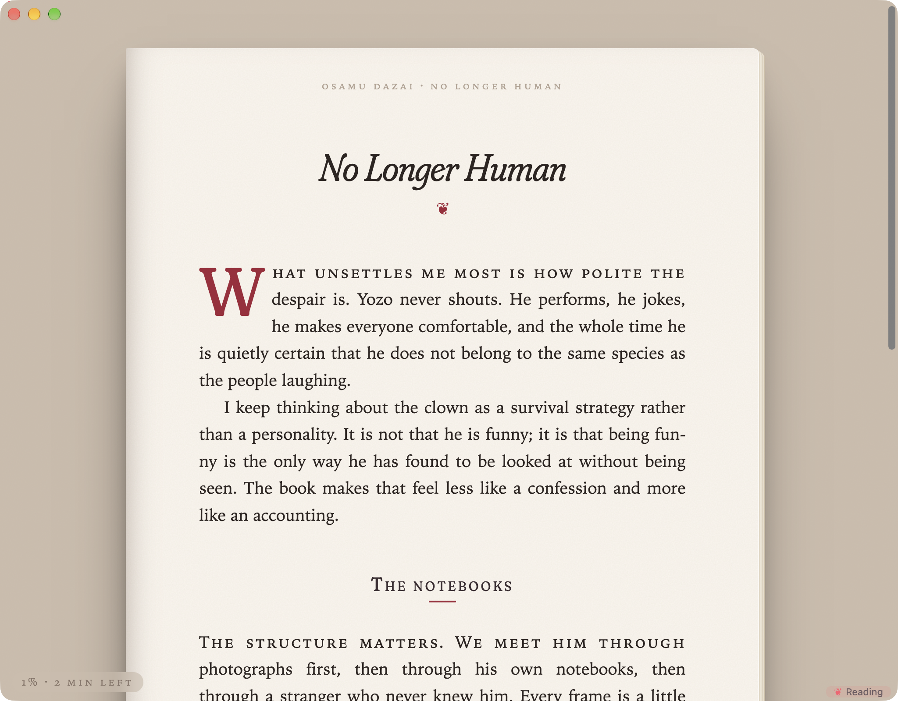
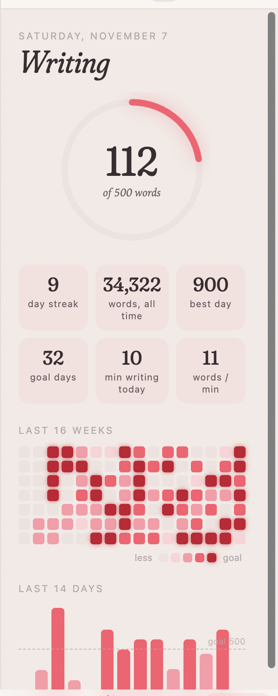
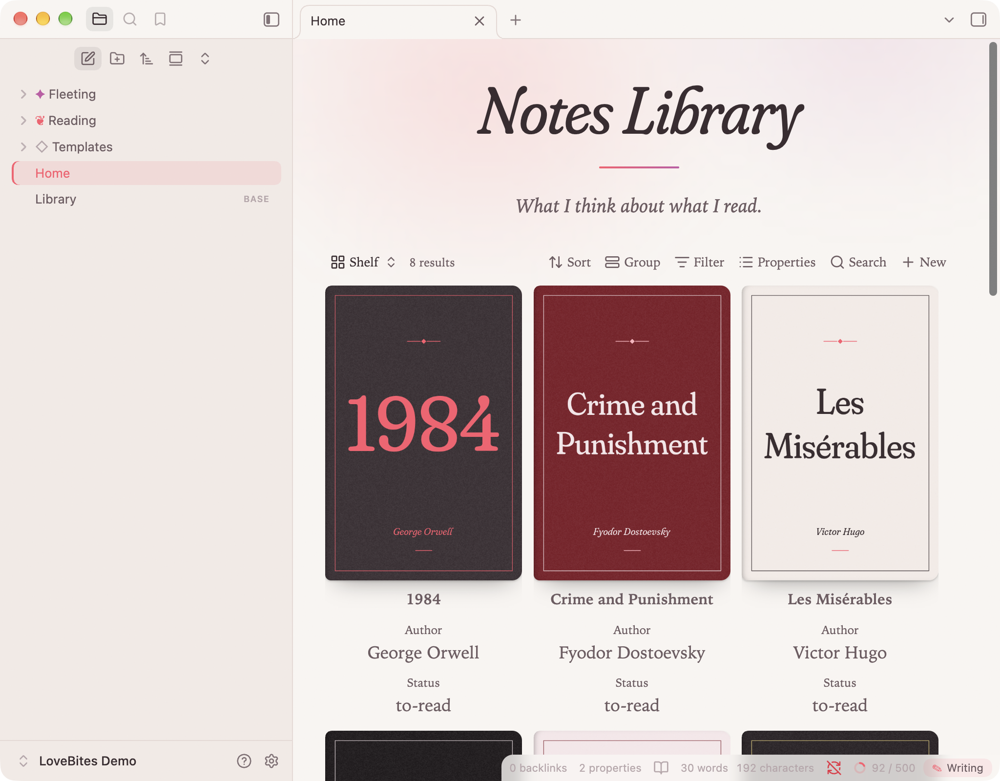

<p align="center">
  
</p>

<h1 align="center">LoveBites</h1>

<p align="center"><em>An animated writing pad that rewards every word, and a reader that turns your notes into a book.</em></p>

---

LoveBites is a plugin for people who write about what they read. It makes Obsidian feel less like a database and more like a desk: paper, ink, a little ceremony when you write, and a quiet page when you read.

## Writing mode

- **A caret that glides** between letters instead of jumping, and breathes when you pause.
- **Petals** drift up from the caret as you type.
- **Blooms** — every 100 words the count blossoms on screen; at your daily goal the page washes pink and says so.
- **Smooth typewriter scrolling** keeps the line you are writing at a fixed height and glides the page up as you go. No separate typewriter plugin needed.
- **The look** — warm paper by day, rose-on-plum by night; Fraunces headings that grow heavier as your pointer rests on them; a shimmering note title; a slow aurora behind each page; paper grain; quiet, near-invisible chrome.

<p align="center"></p>

## Reading mode

Click **✎ Writing** in the status bar (or run *Toggle Reading mode*) and the note becomes a book page: cream paper with stacked page edges and a gutter shadow on a dim desk, justified and hyphenated text with indented paragraphs, a drop cap and small-caps opening line, a running head with author and title, a reading-progress line, and a folio with the minutes left. `Esc` brings you back.

<p align="center"></p>

## Writing statistics

Click the goal ring in the status bar (or the flower in the ribbon):

- today's words in a ring that fills toward your goal
- day streak, words all time, best day, goal days, minutes writing, words per minute
- a 16-week heatmap and the last 14 days as bars, with exact numbers on hover

Only words you type count — pasted text doesn't. History is stored locally in the plugin's data.

<p align="center"></p>

## A bookshelf (optional)

With the LoveBites look on, Obsidian's [Bases](https://help.obsidian.md/bases) card view becomes a shelf: covers with a book-spine shadow that lift and tilt as you hover. Give each book note a `cover:` property pointing to an image and add a Bases card view of your reading folder.

<p align="center"></p>

Book notes with `cssclasses: [book]` also get a drop cap on their opening paragraph.

## Settings

Everything is optional: the full look, accent colour, column width, font size, line height, animations, aurora, paper grain, the gliding caret, petals, typewriter scrolling and its position, milestones, the daily goal, and whether to go still when your operating system's *reduce motion* is on.

## Installing

From Obsidian: **Settings → Community plugins → Browse**, search for **LoveBites**, install, enable.

Manually: download `main.js`, `manifest.json` and `styles.css` from the [latest release](../../releases/latest) into `<vault>/.obsidian/plugins/lovebites/`, then enable LoveBites under Community plugins.

If you use the Typewriter Mode plugin, turn it off — LoveBites does its own typewriter scrolling and the two would fight over the scroll position.

## Privacy

LoveBites makes no network requests, collects no telemetry and only reads the notes you have open. Your writing history lives in the plugin's `data.json` inside your vault.

## Credits

- [Fraunces](https://github.com/undercasetype/Fraunces) by Undercase Type, embedded under the SIL Open Font License 1.1 (`fonts/OFL.txt`).
- The palette comes from the [LoveBites](https://github.com/flyingcakes85/LoveBites) Linux rice by flyingcakes85.
- Book covers in the screenshots are original typographic designs.

## Development

```bash
npm install
npm run build      # type-check, build styles.css (with embedded font) and main.js
npm test           # statistics logic
npx eslint src     # Obsidian's own lint rules
```

The promo video lives in `promo/` (Remotion): `cd promo && npm install && npm run render`.

## License

[MIT](LICENSE)
